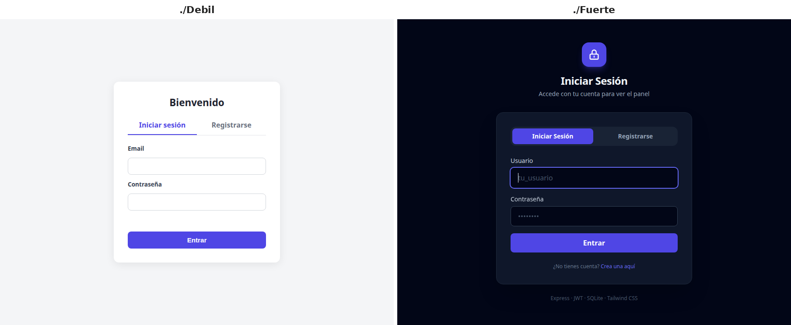

# Prompt Débil vs. Prompt Fuerte

Un experimento controlado de **ingeniería de prompts**: la misma tarea, el mismo modelo, dos
instrucciones distintas. El resultado son dos aplicaciones que **funcionan igual** pero que están
a una distancia enorme de poder desplegarse.

> **La tesis:** el modelo no adivina tus estándares de calidad. Lo que no pides explícitamente
> —logging, validación de configuración, manejo de errores, documentación— simplemente no aparece.



**Tecnologías:** Node.js, Express, JWT, bcrypt, SQLite, HTML/CSS y Tailwind CSS; presentación con Reveal.js.

---

## ⚠️ Aviso de seguridad

**`./Debil` contiene código deliberadamente deficiente y se publica únicamente como material
didáctico.** No lo copies, no lo uses como plantilla y no lo despliegues. Sus fallos están
documentados a propósito en [`HALLAZGOS.md`](HALLAZGOS.md).

Ninguna de las dos carpetas contiene credenciales reales: los archivos `.env` están excluidos del
repositorio y sus valores originales eran cadenas de ejemplo.

---

## El experimento

Ambos proyectos resuelven el mismo enunciado: una aplicación web con **registro y login con JWT,
contraseñas hasheadas con bcrypt, base de datos SQLite y un dashboard protegido** que lista los
usuarios registrados.

| | `./Debil` | `./Fuerte` |
|---|---|---|
| Líneas de código | 534 | 993 |
| Líneas de backend | 118 | 379 |
| Sentencias `console.*` en backend | **1** | **37** |
| Bloques `try/catch` en rutas | **0** | **4** |
| Documentación | ninguna | README de 71 líneas |
| Comentarios / JSDoc | ninguno | en cada función exportada |
| Puerto | 3002 | 3003 |

---

## Los cuatro hallazgos principales

**1. Observabilidad — la diferencia más brutal.**
`./Debil` imprime **una sola línea** en todo su ciclo de vida: el mensaje de arranque. No sabes
quién entró, qué falló ni cuándo. `./Fuerte` registra cada petición HTTP con timestamp e IP, cada
consulta SQL y cada evento de seguridad (`[AUTH]`, `[SECURITY ALERT]`, `[SERVER ERROR]`).

**2. Configuración — fallar pronto vs. fallar en producción.**
`./Debil` usa `process.env.JWT_SECRET` sin validarlo: arranca sin problema aunque falte el `.env`
y revienta con un 500 en el primer login. `./Fuerte` comprueba la variable al arrancar y se niega
a levantar con un mensaje claro.

**3. Manejo de errores — cero red de seguridad.**
`./Debil` no tiene un solo `try/catch` en sus rutas: cualquier fallo de base de datos escapa a
Express y expone el stack trace. `./Fuerte` envuelve cada endpoint, añade un middleware de error
y un 404 en formato JSON para `/api`.

**4. Interfaz — plantilla genérica vs. producto.**
`./Debil` usa HTML plano con 183 líneas de CSS escritas a mano, sin estados de carga: el botón de
login se puede pulsar N veces seguidas. `./Fuerte` usa Tailwind con tema oscuro, spinner, botones
que se deshabilitan, tarjetas de métricas y un aviso explícito cuando la sesión expira.

### Lo que NO es diferente

Para que la comparación sea honesta, conviene decir en qué empatan:

- Los dos usan **bcrypt con salt de 10** y nunca guardan contraseñas en texto plano.
- Los dos usan **consultas parametrizadas**: ninguno es vulnerable a inyección SQL.
- Los dos **escapan el HTML** antes de pintar datos del servidor: ninguno es vulnerable a XSS.
- Los dos fijan versiones con `package-lock.json` v3.
- **Ninguno** incluye un `.env.example`.

Y un matiz que va en contra del titular: en organización de carpetas `./Debil` está *mejor*
separado (`routes/`, `middleware/`, `db/`) que el `server.js` monolítico de `./Fuerte`. Lo que le
falta es sustancia dentro de esa estructura. El análisis completo está en
[`HALLAZGOS.md`](HALLAZGOS.md).

---

## Presentación

[`presentacion.html`](presentacion.html) — 6 diapositivas (Reveal.js + Tailwind, tema oscuro).
Se navega con las flechas del teclado. Ábrelo directamente en el navegador; requiere conexión a
internet porque carga las librerías por CDN.

---

## Compruébalo tú mismo

Los tres experimentos que hacen la diferencia evidente:

### 1. Quita la configuración

```bash
cd Fuerte && mv .env .env.bak && npm start
```

`./Fuerte` se niega a arrancar: `[CONFIG ERROR] Falta la variable JWT_SECRET`. Haz lo mismo en
`./Debil`: arranca con normalidad y solo falla —con un 500 opaco— cuando alguien intenta entrar.

### 2. Observa la consola durante un login

Registra un usuario y entra en cada app mirando la terminal. En `./Debil` no se mueve nada. En
`./Fuerte` verás la traza completa de la petición, la consulta SQL y la generación del JWT.

### 3. Usa un token inválido

```bash
curl -i http://localhost:3003/api/users -H "Authorization: Bearer token-falso"
```

`./Fuerte` responde 401, distingue si el token expiró y deja un `[SECURITY ALERT]` en el log.
`./Debil` responde 401 genérico y no registra nada.

---

## Puesta en marcha

Cada proyecto es independiente. Los archivos `.env` **no** están en el repositorio (a propósito),
así que hay que crearlos:

```bash
cd Debil
npm install
printf 'PORT=3002\nJWT_SECRET=%s\nJWT_EXPIRES_IN=1h\n' "$(openssl rand -hex 32)" > .env
npm start   # http://localhost:3002
```

```bash
cd Fuerte
npm install
printf 'PORT=3003\nJWT_SECRET=%s\nJWT_EXPIRES_IN=1h\n' "$(openssl rand -hex 32)" > .env
npm start   # http://localhost:3003
```

Ambos crean su base de datos SQLite en el primer arranque. Se pueden ejecutar a la vez: usan
puertos distintos.

| Variable | Descripción | `Debil` | `Fuerte` |
|---|---|---|---|
| `PORT` | Puerto del servidor | `3002` | `3003` |
| `JWT_SECRET` | Clave para firmar los tokens | requerida | requerida (validada al arrancar) |
| `JWT_EXPIRES_IN` | Vigencia del token | `1h` | `1h` |

---

## Estructura

```
├── Debil/            Resultado del prompt débil  — 534 líneas
├── Fuerte/           Resultado del prompt fuerte — 993 líneas
├── presentacion.html Comparativa en 6 diapositivas
├── HALLAZGOS.md      Análisis técnico detallado, con referencias a archivo y línea
├── PROMPTS.md        Los dos prompts que originaron cada proyecto
└── README.md
```

---

## Metodología

El análisis se hizo leyendo el código fuente completo de ambos proyectos. Las métricas
(líneas, sentencias `console.*`, bloques `try/catch`, número de paquetes) se midieron con `wc`,
`grep` y los `package-lock.json`, no a ojo. Cada afirmación de [`HALLAZGOS.md`](HALLAZGOS.md)
apunta a un archivo y una línea concretos para que puedas verificarla.
